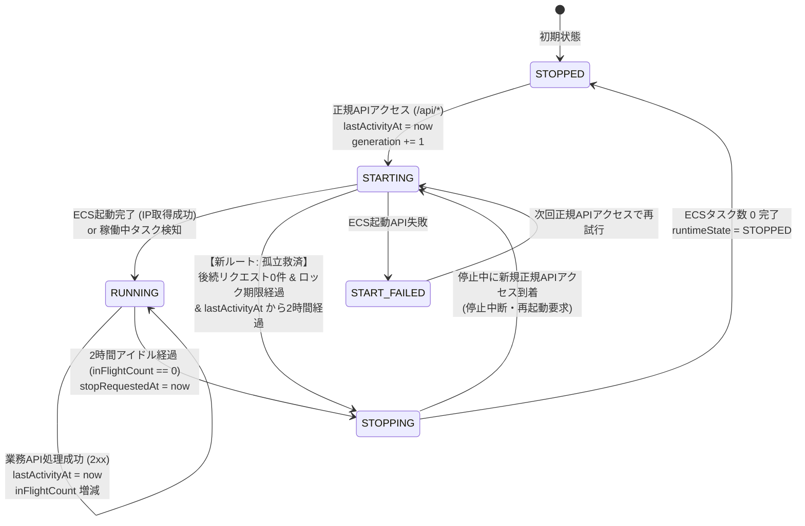

# Data Model: ボットアクセスによる不要起動防止と自動停止の確実化

**Feature**: `005-prevent-bot-ecs-wakeup`  
**Status**: Completed  
**Last Updated**: 2026-11-06  

---

## 1. 概要

本機能では、新規のデータベーステーブルや外部スキーマの作成は行わず、既存の DynamoDB テーブル `SystemActivity`（キー: `entityId="global"`）における状態管理ロジックと属性ライフサイクルを明確化・強化する。

---

## 2. エンティティ定義: `SystemActivity`

### 2.1 テーブル構造
- **テーブル名**: `SystemActivity`（環境変数 `SYSTEM_ACTIVITY_TABLE_NAME` で指定）
- **パーティションキー**: `entityId` (String) - 単一集約レコード `"global"` を使用

### 2.2 属性一覧

| 属性名 | 型 | 役割 | 更新タイミング |
|---|---|---|---|
| `entityId` | String | レコード識別子（常に `"global"`） | 初回作成時 |
| `runtimeState` | String | 現在の調停状態 (`STOPPED`, `STARTING`, `RUNNING`, `STOPPING`, `START_FAILED`) | 状態遷移時 |
| `generation` | Number | 起動世代カウンタ（競合検出用） | 起動要求受付時・起動成功時にインクリメント |
| `inFlightCount` | Number | 現在処理中のリクエスト数 | `begin_in_flight` で +1、`finish_in_flight` で -1 |
| `lastAcceptedAt` | String (ISO8601) | 最後にリクエストを受領した時刻 | `record_request_accepted` 実行時 |
| `lastActivityAt` | String (ISO8601) | **【更新】** 最終有効活動時刻。アイドル自動停止の判定基準 | **起動受付・起動処理時に現在時刻で初期化**。リクエスト 2xx 成功時に最新時刻へ更新 |
| `startRequestedAt` | String (ISO8601) | 起動処理が開始された時刻 | `_claim_start` 実行時 |
| `startOwnerRequestId` | String | 起動権限を獲得したリクエスト識別子 | `_claim_start` 実行時 |
| `startLockExpiresAt` | Number (Unix Epoch) | 起動排他ロックの有効期限（秒） | `_claim_start` 実行時 (現在時刻 + 180秒) |
| `stopRequestedAt` | String (ISO8601) | 停止処理が開始された時刻 | `check_and_auto_sleep` で停止確定時 |
| `lastStateChangedAt` | String (ISO8601) | いずれかの状態が変化した最終時刻 | 状態更新時 |
| `lastErrorCode` | String | 直近のエラーコード（存在時） | 起動/停止失敗時 |
| `lastErrorAt` | String (ISO8601) | 直近のエラー発生時刻（存在時） | 起動/停止失敗時 |

---

## 3. 状態遷移図 (State Machine)

---

## 4. バリデーションルール・整合性制約

1. **`lastActivityAt` の非NULL保証**:
   - バックエンド起動要求が発生した時点で、必ず `lastActivityAt` に ISO8601 形式の現在時刻が書き込まれる。
   - 万が一過去のデータや不整合で `lastActivityAt` が存在しない場合、`check_and_auto_sleep` は `startRequestedAt` または `lastAcceptedAt` をフォールバック値として評価し、判定スキップによる課金継続を防ぐ。
2. **孤立タスクの安全な自動停止制約**:
   - `runtimeState == "STARTING"` の状態で自動停止を行う場合、以下のすべてを満たすことを条件とする:
     - `inFlightCount == 0` (実行中の業務要求が存在しない)
     - `startLockExpiresAt <= nowEpoch` (起動処理のロック期間 180 秒が経過している)
     - `now - lastActivityAt >= 7200` (アイドル判定時間 2 時間が経過している)
3. **世代チェックによる競合防止**:
   - 自動停止処理は、DynamoDB 更新時の条件式 `generation = :expectedGeneration` によって排他制御され、停止直前の新規起動要求と競合した場合は安全に停止処理を中止し再起動する。
